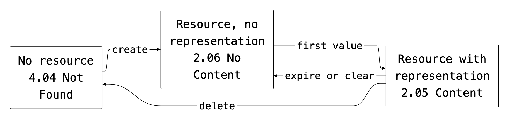
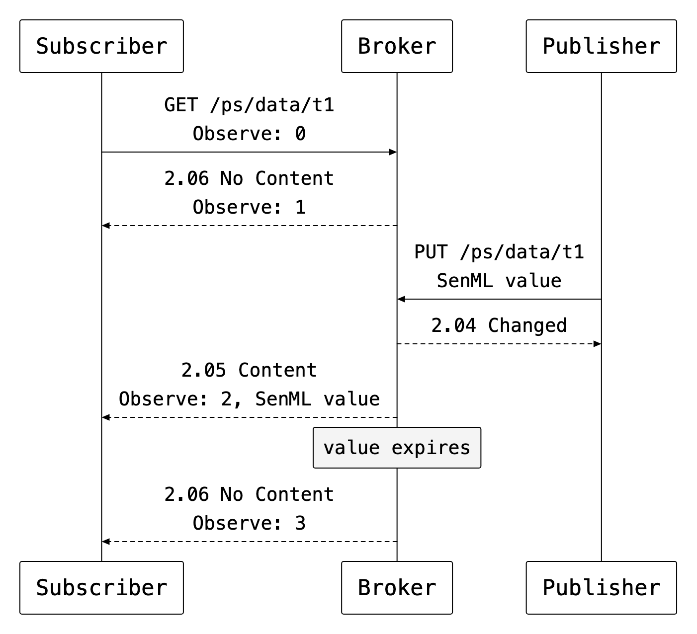
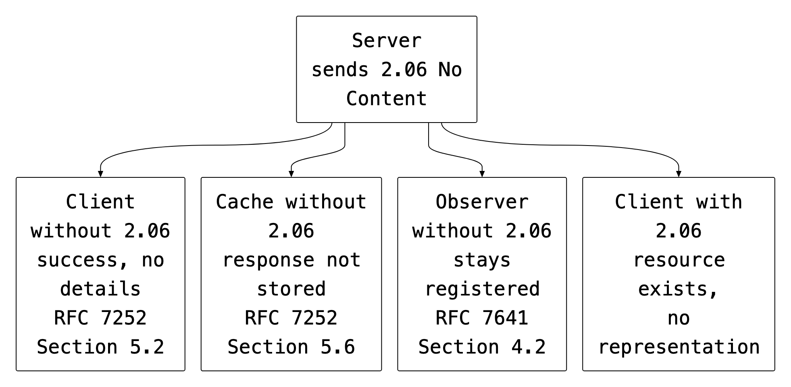

footer: CoAP 2.06 No Content | CoRE WG | Jaime Jiménez
slidenumbers: true
autoscale: true
theme: Next, 9
slide-dividers: #

# [fit] 2.06 No Content
## [draft-jimenez-core-coap-no-content](https://github.com/jaimejim/draft-jimenez-core-coap-no-content)

 

**Jaime Jiménez**, Ericsson
**Carsten Bormann**, Universität Bremen TZI
CoRE WG, October 2026

^ The draft defines a success response code for a resource that exists and has no current representation.

^ It covers GET, FETCH and Observe, and the mapping to HTTP 204.

# Resource states

^ RFC 7252 defines 2.05 Content for a GET on a resource with a representation and 4.04 Not Found for a URI with no resource.

^ The middle state occurs between creation of a resource and its first value, and again when the value is cleared or expires. RFC 7252 Section 5.9.1 defines no success code for a GET in that state.

# Motivation

- In [draft-ietf-core-coap-pubsub](https://datatracker.ietf.org/doc/draft-ietf-core-coap-pubsub/), a topic-data resource exists before the first publication
- The pubsub draft works around this with a half-created topic state, 4.04 responses, and an initialize property for placeholder data
- A sensor whose last reading has expired, or a value that has been cleared, is in the same state

^ The half-created state was raised in the AD review of the pubsub draft.

^ A dedicated code for this state was proposed in [core-wg/coap-pubsub issue 4](https://github.com/core-wg/coap-pubsub/issues/4). The proposal included the rule that a client stops using the previous value.

^ With a dedicated code the broker needs neither the extra topic state nor the placeholder property, and a subscriber can register at any time after topic creation.

# Current practice

| Response | Consequence |
|:--|:--|
| 4.04 Not Found | Terminates the Observe registration; the client polls |
| 2.05 Content, empty payload | Ambiguous: an empty payload is a valid representation in some formats |
| 5.03 Service Unavailable | Reports a server failure that has not occurred |

^ Under RFC 7641 Section 4.2 a non-2.xx notification removes the client from the list of observers.

^ An empty text/plain string or an empty CBOR array is a representation of length 0; a client cannot distinguish "the value is empty" from "there is no value".

# Semantics

- The request succeeded, the target resource exists, and it has no current representation
- No payload, no Content-Format Option, no ETag Option
- Used with GET and FETCH; PUT, POST, PATCH, iPATCH and DELETE keep 2.04 and 2.02
- Cacheable; Max-Age indicates when a representation may become available
- A client holding an earlier representation no longer treats it as current

^ Without an ETag the empty state is not validatable, so there is no 2.03 Valid for it. Whether that is the right choice is [issue 2](https://github.com/jaimejim/draft-jimenez-core-coap-no-content/issues/2).

^ 2.06 is the suggested value; the registry policy is IETF Review or IESG Approval. The HTTP equivalent is 204 No Content, RFC 9110 Section 15.3.5.

# Observe

[.column]

- A registration on a resource without a representation is confirmed with 2.06 and an Observe Option
- When a representation appears, a 2.05 notification follows
- When it disappears, a 2.06 notification keeps the registration and invalidates the previous value
- A client that requires a Content-Format includes Accept in the registration; the server rejects with 4.06

[.column]

^ The registration holds for the whole life of the topic. The pubsub broker needs no half-created state.

^ RFC 7641 Section 4.2 requires the Content-Format of a 2.xx notification to match the initial response. A 2.06 notification carries none. Whether this document therefore updates RFC 7641 is [issue 1](https://github.com/jaimejim/draft-jimenez-core-coap-no-content/issues/1).

# Endpoints without 2.06

^ A server sends 2.06 whenever the semantics apply, without knowledge of the client's capabilities.

^ Per RFC 7252 Section 5.2, an unrecognized Success class code "can only be used to determine that the request was successful without any further details". With no payload and no Content-Format, the result equals a 2.05 with an empty payload. Section 5.6 of the same RFC keeps unrecognized success codes out of caches, and under RFC 7641 only a non-2.xx notification removes an observer.

^ libcoap, Californium and aiocoap deliver an unknown 2.xx code to the application as a success.

# Proxies and HTTP mapping

- 2.06 is end-to-end; a proxy does not translate it per client
- A proxy without 2.06 forwards the response and does not cache it
- HTTP-to-CoAP cross-proxy (RFC 8075): 2.06 ➼ 204 No Content
- CoAP-to-HTTP cross-proxy: 204 on GET ➼ 2.06; RFC 7252 Section 10.1.1 currently yields an empty 2.05

^ RFC 8075 Table 2 defines no mapping for codes absent from the table; the behaviour of an HTTP-to-CoAP proxy without 2.06 is implementation-specific.

^ A libcoap forward proxy cached an unrecognized 2.06 until a July 2026 fix ([libcoap issue 2003](https://github.com/obgm/libcoap/issues/2003)). A cache that stores the response holds it for Max-Age, which is the behaviour specified for a cache with 2.06. Recorded in [issue 4](https://github.com/jaimejim/draft-jimenez-core-coap-no-content/issues/4).

# Design decisions

- Servers send 2.06 unconditionally; endpoints without it see the equivalent of an empty 2.05
- 2.06 means no representation in any format; a representation in a format the client did not request is a matter for Accept and 4.06
- RFC 7252 and RFC 7641 are the normative references; FETCH, the HTTP mapping and RFC 9110 are informative
- Appendix A records the rejected alternatives: empty 2.05, 4.04, 5.03, 2.04 on GET, a placeholder value, a null media type, an RFC 8710 multipart wrapper, and a request option signalling support

^ 4 design questions are closed in the current text.

^ A request option signalling support for 2.06 would follow the pattern of ETag and 2.03 Valid, or Block1 and 2.31 Continue. It was rejected because it costs an option number and 1 byte per request, while the fallback for requests without it is the same empty 2.05.

^ A null media type sent in place of the requested representation conflicts with the Accept Option. An RFC 8710 container fixes the outer format and removes Accept-based selection.

# Open issues

| Issue | Question |
|:--|:--|
| [#1](https://github.com/jaimejim/draft-jimenez-core-coap-no-content/issues/1) | Does this document update RFC 7641? |
| [#2](https://github.com/jaimejim/draft-jimenez-core-coap-no-content/issues/2) | May a 2.06 carry an ETag and be validatable? |
| [#3](https://github.com/jaimejim/draft-jimenez-core-coap-no-content/issues/3) | No representation at all, or none of the intended type? |
| [#4](https://github.com/jaimejim/draft-jimenez-core-coap-no-content/issues/4) | Caches that store an unrecognized 2.xx |

^ Each issue carries a proposed resolution.

^ Issue 1 decides the Updates header and the reference status of RFC 7641. Issue 2 decides the "validatable" entry in the IANA section. Issue 3 proposes keeping the current definition and adding 1 clarifying sentence.

^ Pending text: If-Match and If-None-Match on a resource without a representation, and the RFC 7252 Section 12.1.2 registration checklist in the IANA section.

# Next steps

- Resolve the open issues
- Submit -00 to the datatracker
- Request feedback on the CoRE mailing list

^ The document is an individual submission to the CoRE Working Group.

# [fit] Q&A
